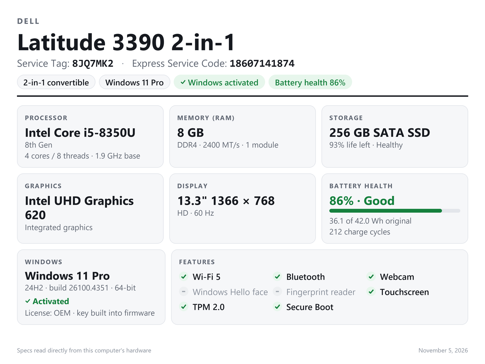

> [!NOTE]
> **Made with AI.** QuickSpecs was written with an AI coding assistant (Claude by Anthropic). It has been tested,
> but double-check the specs it reports before you list a laptop for sale.

# QuickSpecs

**One click, one clean spec sheet for the Windows laptop you're selling.**

Run QuickSpecs on the laptop and it reads the hardware straight from Windows, then makes a listing photo, a printable
spec page and copy-and-paste text. No typing specs by hand, and no guessing what's inside.



<sub>Example made from `samples/sample_latitude3390.json` (made-up laptop).</sub>

## What you get

Each run saves three files in a `reports` folder next to the program:

| File | What it's for |
|---|---|
| `… - ebay.png` | A 1600 × 1200 image with every key spec on one picture. Upload it as one of your listing photos. |
| `… - specs.html` | A full spec page. Add a price and condition notes, print it, save it as a PDF, or copy the listing text. |
| `… - specs.txt` | A short "for eBay" section to paste into your listing, then every detail below it. |

When it finishes, it asks whether to open the HTML page. It never opens anything else on its own.

## What it checks

- **Brand and model**, using the real model name (Lenovo "ThinkPad T480", not "20L5CTO1WW")
- **Serial number** at the top. Dells show the **Service Tag** and **Express Service Code**.
- **Processor** with its generation ("8th Gen", "Core Ultra Series 2", "Ryzen 7000 series"), cores, threads and clock speed
- **Memory**: size, DDR type, speed and how many modules
- **Storage**: size, NVMe / SATA SSD / HDD, drive health, and SSD life left
- **Graphics**: integrated or dedicated, with video memory
- **Display**: screen size, native resolution and refresh rate
- **Battery health** as a percentage of the original capacity, with charge cycles
- **Windows** edition, version and build, **activation status** and license type
- **Features**: Wi-Fi generation, Bluetooth, webcam, **Windows Hello face login**, fingerprint reader, touchscreen,
  pen, Ethernet, TPM and Secure Boot

## Getting started

### The easy way: the exe

1. On your own PC, install [Python 3.10+](https://www.python.org/downloads/) and double-click **`build_exe.bat`**.
2. Copy `dist\QuickSpecs.exe` to a USB stick.
3. On each laptop you sell, double-click `QuickSpecs.exe`.

The exe is a single file and needs nothing installed on the laptop. Reports collect in a `reports` folder on the stick.

### From source

```bash
pip install pillow
python quickspecs.py
```

Or double-click `QuickSpecs.bat`.

### Tips

- **Run as administrator** (right-click, *Run as administrator*) to also see SSD life left and power-on hours.
- **Unplug external monitors** so the display info is for the laptop's own screen.
- eBay discourages text on the main photo, so use the image as an extra photo, not the first one.

## Options

| Option | What it does |
|---|---|
| `--no-open` | Don't ask to open the HTML page |
| `--no-image` | Skip the eBay image |
| `--out FOLDER` | Save the files somewhere else |
| `--save-raw` | Also save the raw hardware data as JSON |
| `--from-json FILE` | Make the sheets from saved raw data instead of scanning this PC |

Try it without a laptop using the samples:

```bash
python quickspecs.py --from-json samples/sample_latitude3390.json
```

## How it works

QuickSpecs uses only tools that come with Windows: PowerShell and WMI, `powercfg` for the battery report, `netsh`
for Wi-Fi, and the Windows display APIs. The image is drawn with Pillow using the Windows fonts, so no browser is
needed.

| File | Job |
|---|---|
| `quickspecs.py` | The main program |
| `collect.py` | Reads the hardware |
| `specs.py` | Turns raw data into clean values: model names, drive sizes, CPU generation, battery health |
| `render.py` | Builds the HTML page and the listing text |
| `card_image.py` | Draws the eBay image |
| `build_exe.bat` | Builds the single-file exe with PyInstaller |
| `samples/` | Made-up laptops for testing |

## Requirements

- Windows 10 or 11
- Python 3.10+ and Pillow, only for running from source or building the exe
